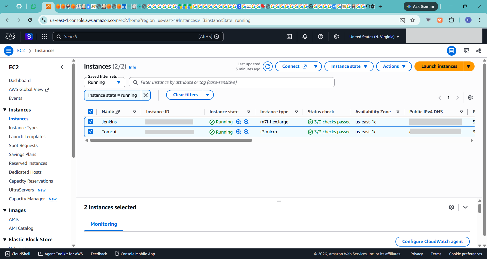
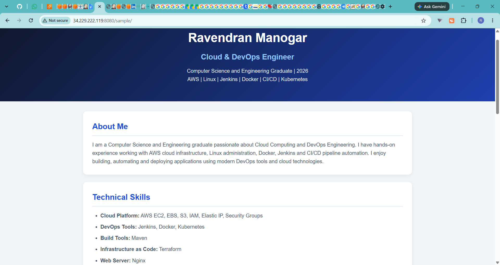
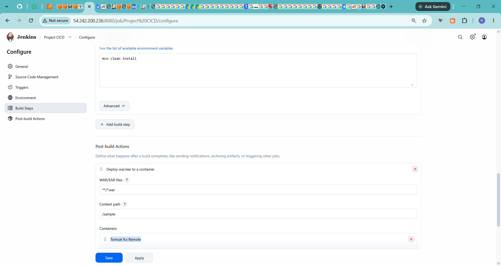
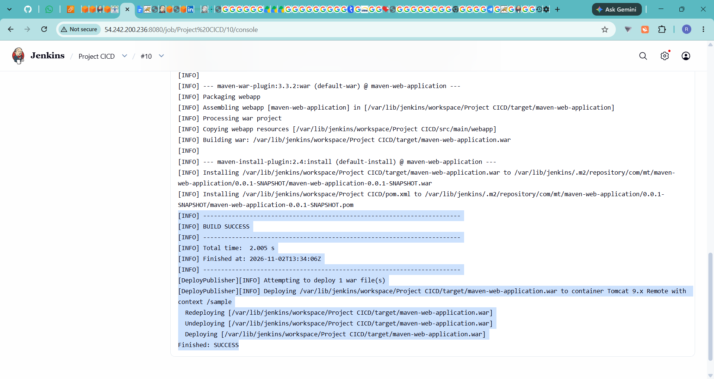

# Jenkins CI/CD – Maven Build & Tomcat Deployment on AWS EC2

## 📌 Project Overview

This project demonstrates a CI/CD workflow using Jenkins to build a Java web application with Maven and deploy the generated WAR artifact to a remote Apache Tomcat 9 server hosted on AWS EC2.

I configured Jenkins to automate the Maven build process and deploy the generated WAR file to a remote Tomcat server using the Jenkins deployment configuration.

The project helped me understand how build automation, artifact packaging, and application deployment work together in a real-world DevOps workflow.

## 🏗️ Architecture

```text
              Source Code
                   |
                   v
            Jenkins Server
              (AWS EC2)
                   |
                   v
          Maven Build Process
           mvn clean install
                   |
                   v
             WAR Artifact
                   |
                   v
      Jenkins Deploy WAR/EAR Plugin
                   |
                   v
        Remote Apache Tomcat 9
              (AWS EC2)
                   |
                   v
         Deployed Web Application
```

## ☁️ AWS Infrastructure

The project was deployed using AWS EC2 instances.

| Server | Role | Technology |
|---|---|---|
| Jenkins Server | Build automation and deployment | Jenkins |
| Application Server | Hosts the deployed Java application | Apache Tomcat 9 |

### Infrastructure Components

- Amazon EC2
- Linux server instances
- Jenkins
- Apache Tomcat 9
- AWS Security Groups

## 🛠️ Technologies Used

- AWS EC2
- Jenkins
- Apache Maven
- Apache Tomcat 9
- Java
- Git
- GitHub
- Linux

## ⚙️ Implementation Steps

### 1. AWS EC2 Setup

- Launched EC2 instances for Jenkins and Tomcat.
- Configured the required security groups.
- Established connectivity between Jenkins and the Tomcat server.

### 2. Jenkins Configuration

- Configured Jenkins on the EC2 instance.
- Created a Jenkins Freestyle project.
- Configured the project build settings.

### 3. Maven Build Configuration

Configured the Jenkins build step to execute:

```bash
mvn clean install
```

Maven performs the project build and packages the Java web application into a WAR file.

### 4. WAR Deployment Configuration

Configured the Jenkins post-build deployment action:

**Deploy war/ear to a container**

Configuration:

| Setting | Value |
|---|---|
| WAR/EAR Files | `**/*.war` |
| Context Path | `/sample` |
| Container | Tomcat 9.x Remote |

Jenkins deploys the generated WAR file to the configured remote Tomcat server.

### 5. Application Verification

After a successful build and deployment, verified the deployed application using the Tomcat server's public IP address.

Application URL format:

```text
http://<TOMCAT-PUBLIC-IP>:8080/sample/
```

## 🔄 Deployment Workflow

1. Source code is available in the Git repository.
2. Jenkins executes the configured job.
3. Maven runs `mvn clean install`.
4. The Java application is compiled and packaged into a WAR file.
5. Jenkins identifies the generated WAR artifact.
6. Jenkins deploys the WAR to the configured remote Tomcat 9 server.
7. Tomcat deploys and serves the application.
8. The application is accessed through the server endpoint.

## 📸 Project Screenshots

### AWS EC2 Infrastructure

Jenkins and Tomcat instances running on AWS EC2.



### Deployed Application

The deployed Java web application accessible through the Tomcat server.



### Jenkins Build Output

Maven build and WAR deployment completed successfully.



### Jenkins Deployment Configuration

Maven build command and remote Tomcat WAR deployment configuration.



## 🎯 What I Learned

Through this project, I gained practical experience with:

- AWS EC2 instance provisioning
- Linux server administration
- Jenkins job configuration
- CI build automation
- Maven build lifecycle
- Java application packaging
- WAR artifact deployment
- Jenkins post-build actions
- Remote Tomcat deployment
- Application deployment troubleshooting
- Cloud infrastructure and server communication

## 🚀 Future Improvements

- Implement GitHub webhook-based triggering.
- Create a Jenkins Pipeline using a Jenkinsfile.
- Add automated testing stages.
- Integrate Docker into the deployment workflow.
- Improve deployment automation and rollback strategy.
- Implement monitoring and logging.

## 👨‍💻 Author

**Ravendran Manogar**

Aspiring Cloud & DevOps Engineer

Skills: AWS | Linux | Jenkins | Docker | Git | Networking

[Connect with me on LinkedIn](https://www.linkedin.com/in/ravendran-manogar/)
